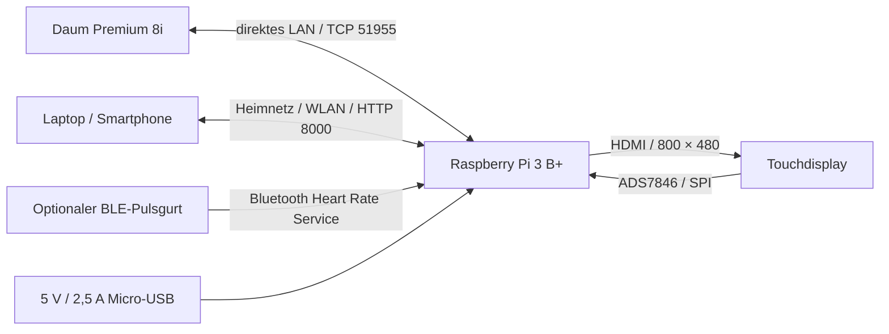

# Hardwarebasis

Stand: 4. November 2026. Die Angaben zur vorhandenen Installation wurden am Pi aus Gerätemodell, Display-Modi und Eingabegeräten ausgelesen.

## Vorhandener Aufbau

| Teil | Vorhandene Hardware / Anschluss | Zweck |
| --- | --- | --- |
| Trainingsgerät | Daum Premium 8i, Premium-TCP-Protokoll | Lastvorgabe und Bike-Messwerte |
| Rechner | Raspberry Pi 3 Model B Plus Rev 1.3, aarch64 | Webserver, Trainingssteuerung und Bluetooth |
| Display | HDMI-Display mit 800 × 480 Bildpunkten | Lokale Chromium-Kioskansicht |
| Touch | ADS7846 Touchscreen, SPI0.1 | Touch-Eingabe am Display |
| Bike-Netz | Direktes Ethernet-Kabel Daum ↔ `eth0` | Dedizierte Verbindung zum Bike |
| Heimnetz | WLAN am Pi | Zugriff von Laptop und Smartphone |
| Speicher | microSD mit Linux und lokaler SQLite-Datenbank | Betriebssystem und Trainingsdaten |
| Optional | Bluetooth-LE-Pulsgurt | Echte Herzfrequenzmessung |

Hersteller und Diagonale des Displays wurden nicht eindeutig ermittelt. HDMI übernimmt das Bild, SPI den Touch; ein USB-Touchscreen ist nicht Voraussetzung dieses Aufbaus.

Der Pi 3 B+ hat laut [Herstellerdatenblatt](https://www.raspberrypi.com/products/raspberry-pi-3-model-b-plus/) einen 1,4-GHz-Vierkernprozessor, 1 GB RAM, WLAN und Bluetooth 4.2/BLE. Er benötigt eine stabile 5-V-/2,5-A-Versorgung über Micro-USB. Die Stromversorgung eines zusätzlichen Displays muss passend zum Display ausgelegt werden.

## Verbindungen

## Daum-Netzwerk

| Einstellung | Wert im Referenzaufbau |
| --- | --- |
| Daum-IP | `192.168.10.1/24` |
| Pi-Ethernet | `192.168.10.2/24` auf `eth0` |
| TCP-Port | `51955` |
| Gateway auf Bike-LAN | keines |
| Standardroute / Internet | weiterhin über WLAN |
| Cockpit | Fernsteuerung EIN, Bedienung sperren AUS, Automatisch, Standardprotokoll |

Diese Adressen gehören zum direkten Bike-Netz. Die WLAN-IP des Pi wird im Heimnetz vergeben. Der Hostname der vorhandenen Installation ist `ghapi3.local`; andere Installationen können einen eigenen Namen verwenden.

## Touch-Konfiguration

Das vorhandene Setup nutzt `dtparam=spi=on` und das Overlay `ads7846` mit `cs=1` und `penirq=25`. Die vollständigen Parameter stehen in [configure-touch.py](../bike/deploy/configure-touch.py). Das Skript verändert `/boot/firmware/config.txt` und ist für diesen konkreten Touchcontroller bestimmt; bei anderer Hardware deren Anleitung verwenden.

## Pulsgurt und weitere Bediengeräte

Ein Pulsgurt ist für Watttraining optional. Für Pulssteuerung ist ein frisches Signal über Bluetooth LE erforderlich; reine ANT+-Gurte werden nicht unterstützt. Die Suche und Kopplung erfolgen auf dem Pi. Laptop und Smartphone sind Browser-Clients und benötigen keinen eigenen Bike-Anschluss. Die Apple-Watch-Brücke ist beschrieben, aber am Referenzgerät noch nicht praktisch geprüft.

## Ein- und Ausschalten

- Der Pi startet, wenn sein Netzteil neu angeschlossen wird.
- Die optionale Automatik fährt nach fünf Minuten ohne direkten `eth0`-Link herunter und speichert vorher ein laufendes Training.
- Ein Switch zwischen Pi und Daum kann den Link aufrechterhalten. Die Abschalterkennung ist für ein direktes Kabel vorgesehen.
- App → Einstellungen und „Daum Autoabschalten EIN-AUS“ auf dem Desktop schalten dieselbe Automatik um.
- Der Pi 3 B+ unterstützt im vorhandenen Aufbau kein normales Wake-on-LAN. Einschalten allein durch den Daum benötigt zusätzliche externe Hardware. [Raspberry-Pi-Forum](https://forums.raspberrypi.com/viewtopic.php?t=226046)
- Der Bildschirmschoner ist eine getrennte Funktion: schwarzes Bild nach fünf Minuten ohne Bedienung, ohne den Pi oder das HDMI-Signal abzuschalten. Touch holt die Ansicht zurück.

Andere Pi-Modelle, Touchcontroller und Daum-Geräte sind durch diese Dokumentation nicht als getestet ausgewiesen.
